# dsh-model-switcher-pro

[](https://github.com/ZSQS88/dsh-model-switcher-pro/releases/latest)
[](https://github.com/ZSQS88/dsh-model-switcher-pro/releases)
[](LICENSE)

An enhanced model picker **and Codex-style reasoning-effort slider** for the
[DeepSeek Harness](https://github.com/deepseek-ai/deepseek-harness) (dsh) composer,
for both the **Web** profile and the **Desktop** (Electron) app.

> **Derivative work.** This package is an enhanced fork of
> [`dsh-model-switcher`](https://github.com/youssefsiam38/dsh-plugins) by
> **Youssef Siam**, used under the **MIT** license. The original picker, its
> keyboard model, enrichment reads, and `modelSwitcher` service are preserved;
> this fork adds the reasoning-effort slider design, a dark/light token pass, and
> an opt-in host-composer restyle. See [Attribution](#attribution) and
> [NOTICE](NOTICE). It is published under a new name because `dsh-model-switcher`
> is already taken on npm by the upstream author.

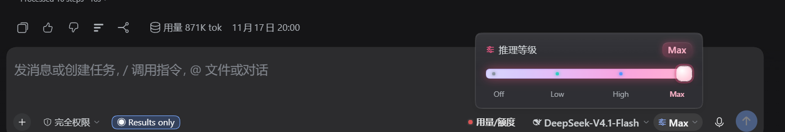

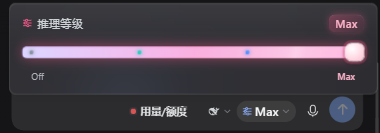

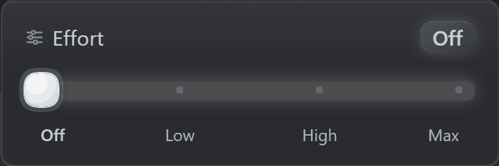

## What this fork adds

- **Reasoning-effort slider beside the model trigger.** A compact button shows the
  current level (for example `High`) and opens a slider popover. The slider lists
  only the levels the model's adapter advertises (plus **Default** when the adapter
  has none); models without reasoning metadata hide the button.
  - **Named tiers** with a per-tier signature palette, **magnetic detents** that
    settle on each level, and a **damped glide** (170 ms) while dragging.
  - A **Max flow** treatment at the top tier, animated tick/sheen feedback, and a
    live value readout. Dragging previews the level; releasing the pointer or an
    arrow key commits it and keeps the popover open.
  - Full **ARIA** slider semantics, keyboard control (←/→/↑/↓, Home/End, Esc), and
    a `prefers-reduced-motion` path that drops the animation while keeping the
    thumb centered.
- **Dark / light token pass.** The picker and effort popover read the host theme
  tokens (`body[data-ds-dark-theme]` for dark, its absence for light), with a
  light-scheme contrast pass so tier ink, tracks, ticks, and hints stay legible.
- **Design-only polish.** Roomier rows, a unified type ladder, token-based hover
  and press feedback, and narrow-screen fallbacks (ends-only effort scale under
  520 px; full-width bottom sheet on phones). No business logic is changed.
- **Opt-in host-composer restyle** (`composerRestyle`, default **OFF**). Larger
  prompt, calmer radius, a focus ring on the whole card, and press/hover feedback.
  These selectors are host-global, so they ship in a separate sheet the client
  only mounts when you explicitly enable them.

The base picker is unchanged in behavior:

1. **Provider select** at the top: searchable, "All providers" by default. Each
   provider shows its logo, model count, and key status (**Signed in**, **Ready**,
   **Needs key**, **Failed to load**).
2. **Model search** below: fuzzy over model name/id and provider name/id, grouped
   by provider, with context-window, **Vision**, and **Reasoning** badges, a star,
   and **Favorites** / **Recent** on top while the search is empty.

Other plugins can open the same popover to pick one or several models (see
[For plugin authors](#for-plugin-authors)).

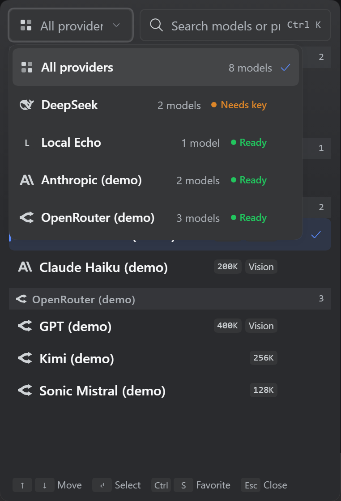

| Dark | Light | Phone sheet |
|---|---|---|
| 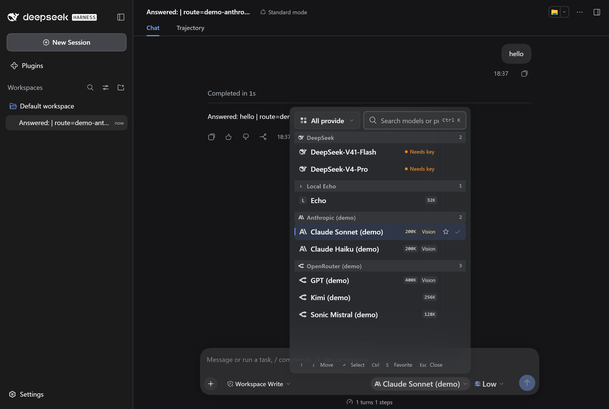 | 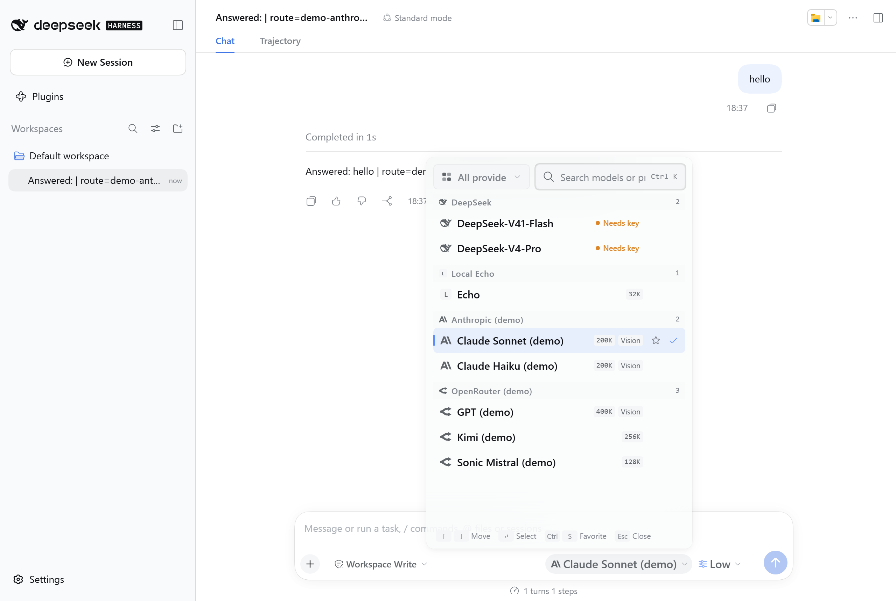 | 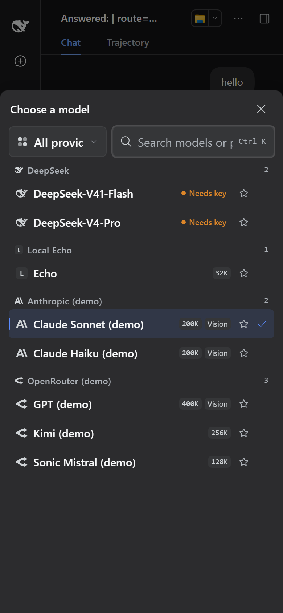 |

*Picker screenshots illustrate the base UI carried over from upstream; the
reasoning-effort slider and the design pass are described above.*

## Contents

- [Install](#install)
- [Using it](#using-it)
- [Keyboard](#keyboard)
- [Configuration](#configuration)
- [What it changes](#what-it-changes)
- [For plugin authors](#for-plugin-authors)
- [Compatibility](#compatibility)
- [Uninstalling](#uninstalling)
- [Development](#development)
- [Attribution](#attribution)

## Install

This plugin is distributed from **GitHub** (not published to npm). Install by
GitHub spec, or from the prebuilt Release tarball.

Web profile:

```sh
dsh plugin --profile web add github:ZSQS88/dsh-model-switcher-pro
```

Desktop app: open **Plugins** and install by GitHub spec
`github:ZSQS88/dsh-model-switcher-pro`. The desktop profile drives the renderer;
**fully restart the app** to reload client plugins.

Prebuilt tarball (skips the build-approval step): download
`dsh-model-switcher-pro.tgz` from the
[v0.4.1 Release](https://github.com/ZSQS88/dsh-model-switcher-pro/releases/latest),
then:

```sh
dsh plugin --profile web add ./dsh-model-switcher-pro.tgz
```

The bundle patch (`cordis.patch.yml`) inserts one plugin row:

```yaml
- insert:
    - id: model-switcher-pro
      name: dsh-model-switcher-pro
```

Restart dsh (or the desktop app) if the profile does not reload live.

## Using it

Click the model control in the composer (or focus it and press Enter). The
popover opens with focus in the model search:

- Type to filter. Matching is fuzzy over model name, model id, and provider name
  and id. Every word must match something; name matches rank above provider
  matches; ties go to favorites, then recents.
- ↑/↓ to move, Enter to pick. The choice applies to the session's next request,
  exactly as the stock control.
- Shift+Tab reaches the provider select; Enter returns to the model search scoped
  to that provider. **All providers** searches everything again.
- Star a row (or Ctrl+S / ⌘S) to favorite it. Recent picks appear under **Recent**.
  Both sections show only while the search is empty. Favorites and recents live in
  this browser (`localStorage`, key `dsh-model-switcher:v1`, kept stable across the
  rename so existing history survives) and are shared across tabs.
- The **Reasoning effort** button sits beside the model trigger. Click it to open
  the slider; drag or use arrow keys to change level; release to commit. Picking a
  model from the list applies that model's default effort.

## Keyboard

| Where | Key | Action |
|---|---|---|
| Model search | ↑ / ↓, Ctrl+P / Ctrl+N | Previous / next model (wraps) |
| | PageUp / PageDown | Move 8 rows |
| | Enter | Pick the active model |
| | Ctrl+S / ⌘S | Toggle Favorites on the active model |
| | Esc | Clear the search; if empty, close |
| Provider search | ↑ / ↓ | Previous / next provider |
| | Enter | Pick provider, return to model search |
| | Esc | Clear, return to model search, then close |
| Effort popover | ← / →, ↑ / ↓ | Move between levels |
| | Home / End | First / last level |
| | Esc | Close, return focus to the effort trigger |
| Model popover | Tab / Shift+Tab | Cycle provider search → model search (and Close on phones) |

The active row is announced via `aria-activedescendant`; both searches are ARIA
comboboxes controlling a listbox; models are grouped with `role="group"`; the
result count is announced in a polite live region. The effort slider exposes
`role="slider"` with `aria-valuemin/max/now/text`. Closing returns focus to the
composer control.

## Configuration

All settings are optional. Override them in your profile's `cordis.patch.yml` by
targeting the row id `model-switcher-pro`:

```yaml
- id: model-switcher-pro
  config:
    priority: -10          # slot rank; must be negative (the stock control is 0)
    initialFocus: models   # or `providers` to open on the provider search
    recentLimit: 3         # 0 to 20; 0 hides the Recent section
    metadata: true         # context windows / input types via llm.discoverModels
    providerStatus: true   # key status via settings/credentials describe
    composerRestyle: false # opt-in host-composer restyle (host-global selectors)
    providerIcons:         # logo overrides by provider id (http/https/data:image)
      my-gateway: https://example.com/gateway.svg
```

Invalid values fail when the row loads. The Host half passes the settings to the
page as the `__DSH_MODEL_SWITCHER__` global through `webserver/index-inject`. In a
profile without the Web server nothing listens for that event and the plugin is
inert.

`composerRestyle` is **OFF by default**: its selectors target the host composer
globally, so enabling it forces this plugin's typography/geometry on the whole
input bar. Turn it on only if you want that look.

If another plugin also replaces the model control, the lower priority wins. Two
plugins at the same priority make the second registration fail — change
`priority` if you see that error.

## What it changes

- **Composer model control**: replaced. Registers in `conversation.input.model` at
  priority `-10` (stock stays at `0`; lowest renders). Writes through the same
  directory call as stock (`session.selectModel`): picking a model sends provider
  and model (Host applies that model's default effort); the effort popover sends
  the current model with the chosen effort; re-picking the current model closes
  without a write; a refused selection keeps the popover open and shows the stock
  toast; a `locked` composer disables the trigger; addressed subagent sessions get
  no control; compact mode is honored.
- **`/model` popup, Settings pickers**: unchanged. They share the same directory.
- **Host composer**: unchanged unless `composerRestyle: true`.
- Adds no session events, no Host routes, no model-visible input. Adds one browser
  service, `modelSwitcher`.

## For plugin authors

The browser half provides a Cordis client service `modelSwitcher`. Its `pick()`
opens the same popover (bottom sheet on phones) in picker mode: choosing a model
changes no session. It lists the Host catalog (`session.modelCatalog`). The effort
control is not shown; the caller owns efforts.

```ts
pick(options?: {
  anchor?: HTMLElement      // open below this element, return focus to it; omitted: centered
  multiple?: boolean        // check several, confirm with Done (or Ctrl/Cmd+Enter)
  max?: number              // most models a multiple pick returns
  exclude?: ModelRef[]      // models to leave out
  initial?: ModelRef[]      // models checked when a multiple pick opens
  title?: string            // dialog label / sheet title
}): Promise<ModelRef[] | undefined>   // ModelRef = { provider: string; model: string }
```

Read the service at call time rather than listing it in `inject`, so your plugin
still loads without the switcher. Types are published as a types-only entry,
`dsh-model-switcher-pro/service`:

```ts
import type { ModelSwitcherService } from 'dsh-model-switcher-pro/service'

function switcher(ctx: Context): ModelSwitcherService | undefined {
  const service: unknown = ctx.get('modelSwitcher' as never)
  return typeof (service as { pick?: unknown } | undefined)?.pick === 'function'
    ? service as ModelSwitcherService : undefined
}

const picked = await switcher(ctx)?.pick({ anchor: button, multiple: true, max: 3 })
if (picked !== undefined) addModels(picked)
```

## Compatibility

- dsh `>=0.2.0-rc.1`, **Web** profile and **Desktop** (Electron) renderer. The
  desktop profile drives the same web client; fully restart the app to reload.
- The composer picker needs `@deepseek-ai/dsh-client-ui-model-selection` (shipped by
  the Web profile). Without it the plugin registers nothing in the slot, so any
  other occupant keeps working. The `modelSwitcher` service needs the `session`
  Remote namespace for the catalog.
- Key status needs `settings` + `credentials` Remote namespaces; metadata needs
  `llm.discoverModels`. Either missing only removes its enrichment.
- React 18 is provided by the dsh shell. The browser bundle includes
  [match-sorter](https://github.com/kentcdodds/match-sorter) 8.3.0 and
  remove-accents; about 36 kB gzipped.
- Node.js `^22.19 || >=24`.

## Uninstalling

```sh
dsh plugin --profile web remove dsh-model-switcher-pro
```

The stock control returns on the next load. Nothing is stored on the Host. The
browser keeps favorites/recents under `dsh-model-switcher:v1` until you clear site
data.

## Development

```sh
npm install
npm run marks         # regenerate provider marks (pinned simple-icons)
npm run build         # lib/index.js (host) + lib/client.js (browser)
npm run typecheck
npm run check:bundle  # assert client bundle id and host name == package name
npm test              # 74 unit tests
npm run pack:tarball  # writes .artifacts/dsh-model-switcher-pro-<version>.tgz
```

> Node 25+/26 ships an experimental native `localStorage` that shadows jsdom's in
> tests (`Cannot read properties of undefined (reading 'clear')`). Either use
> Node 22/24, or run `NODE_OPTIONS=--no-experimental-webstorage npm test`. This
> affects the test environment only, not the shipped browser bundle.

Unit tests cover ranking/grouping, favorites/recents storage, enrichment reads and
wire validation, the component (ARIA, keys, provider→model handoff, Tab cycle,
effort trigger/popover, the design pass and its `composerRestyle` gating, light
scheme, phone sheet), the browser plugin on a real Cordis context, the
`modelSwitcher` service, and the Host half through the Loader (including config
that must be refused). The browser test (`e2e/`) installs the packed plugin into a
throwaway `DSH_HOME` and drives Chromium end to end.

## Screenshots

Reasoning-effort tiers, each with its own signature palette (Off → Low → Medium → High → Xhigh → Max), plus the Max-tier flow and the damped drag glide:

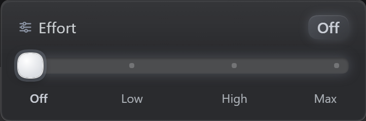
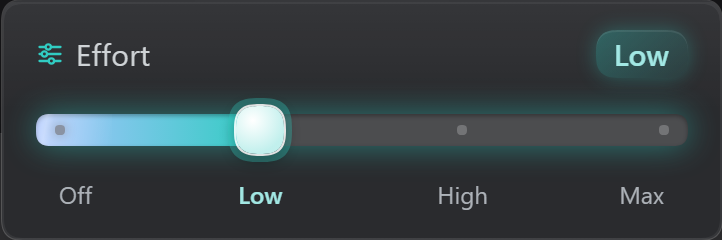
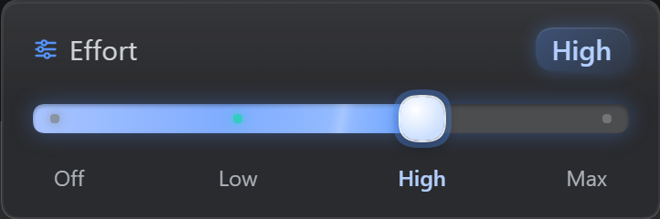
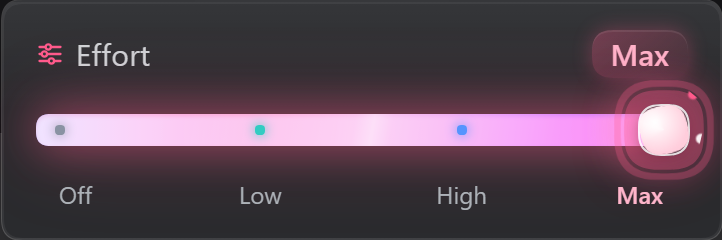
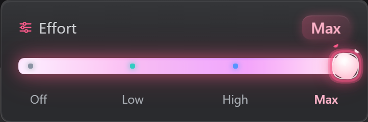
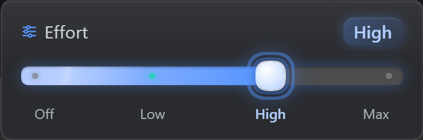

Dark and light schemes, effort popover and model picker:


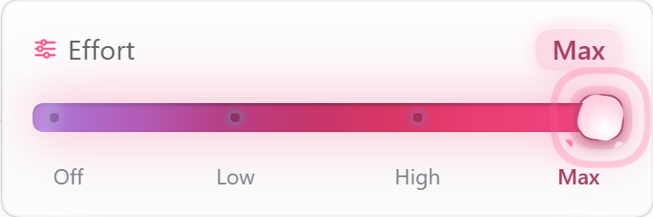
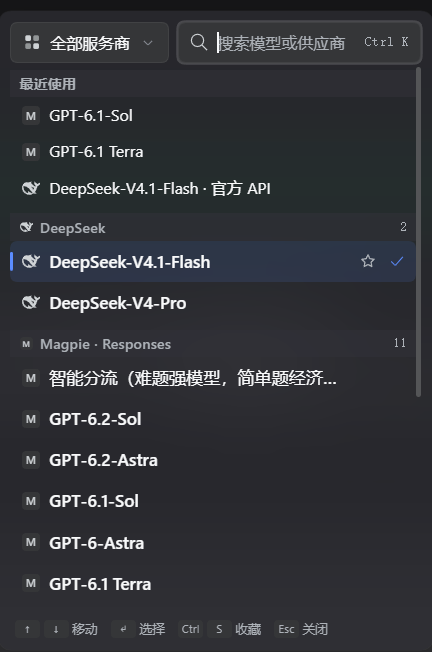
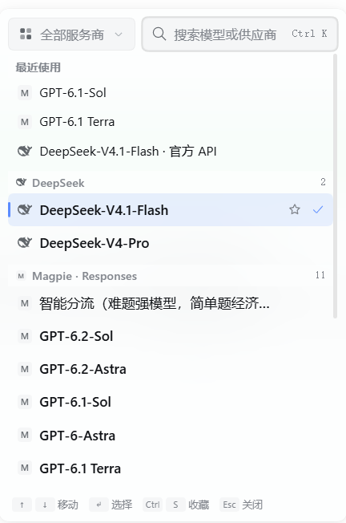

Narrow screen (ends-only scale, full-width sheet):


## Attribution

MIT. This is a derivative of **Youssef Siam**'s
[`dsh-model-switcher`](https://github.com/youssefsiam38/dsh-plugins); the upstream
copyright and permission notice are retained in [LICENSE](LICENSE), and the
modifications are summarized in [NOTICE](NOTICE). Provider marks come from
[simple-icons](https://github.com/simple-icons/simple-icons) (CC0-1.0); the brands
belong to their owners.